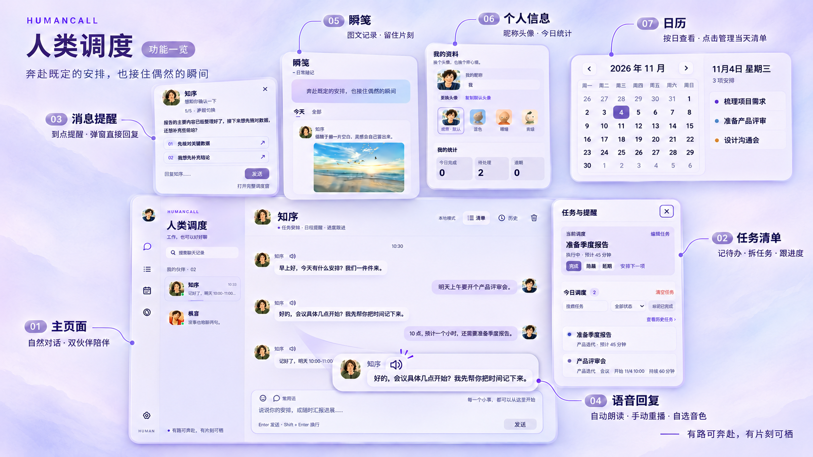

# 人类调度 Humancall · AI 待办清单与任务管理工具

用自然语言记待办、拆任务、安排日程，让 AI 在合适的时候提醒你。

**AI-powered to-do list, task manager and reminder app for Windows and macOS.**

人类调度是一款以**待办清单（To-do List）**为核心的桌面效率工具，将任务管理、日程安排、截止时间和桌面提醒放在一起。你可以直接说出要做的事，让 AI 先记入清单，再补充时间、拆分步骤和跟进进度；也可以手动添加、编辑、搜索和筛选任务，管理工作与生活中的待办事项。

## 待办清单、任务管理与日程提醒

- **AI 待办清单 / To-do List**：聊天记录待办，时间没定也先保存，避免想做的事被漏掉。
- **任务管理 / Task Management**：总任务与子任务、优先级、开始与截止时间，以及完成、阻塞和延期等状态。
- **日程安排与提醒 / Planner & Reminders**：会议与预约、一次性或每天／每周提醒，通过桌面气泡接收通知和回复进度。
- **日历 / Calendar**：按日期查看事项，点击日期展开当天清单，直接管理任务与重复提醒；未定日期的工作收在“未排期”。
- **桌面效率助手 / Productivity Assistant**：支持 Windows 与 macOS，任务和设置保存在本机，可自行配置大模型 API。

内置“知序”和“枫言”两位 AI 伙伴，可通过聊天管理清单、汇报进度，也能聊聊日常。你可以选择温柔陪跑、友好助理、耐心教练或老板模式，让提醒和表达方式适合自己的节奏。

## 下载与使用

当前桌面版本 **v0.1.26**，完整改动见 [更新日志](CHANGELOG.md)。

**[前往 GitHub Release 下载最新版](https://github.com/pttman/Humancall/releases/latest)**

提供 Windows x64 安装程序和 macOS 通用 DMG（Apple 芯片 / Intel，macOS 11 及以上），无需安装 Node.js 或准备开发环境。

**Windows**

1. 在 Release 中下载 **`Humancall-Setup-版本号-x64.exe` 安装程序**。
2. 双击安装，按向导选择安装位置和数据保存位置。
3. 安装完成后，通过桌面或开始菜单的“人类调度”快捷方式启动。

**macOS**

1. 下载 **`Humancall-版本号-mac-universal.dmg`**，打开后将“人类调度”拖入 Applications（应用程序）。
2. 从应用程序中启动。当前 Mac 包使用本地临时签名，尚无 Apple Developer ID 签名与公证；首次打开若被系统拦截，请在“系统设置 → 隐私与安全性”中针对本应用选择“仍要打开”。如果仍无法打开，请到 Issues 附上系统版本和提示截图。
3. 数据默认保存在 `~/Library/Application Support/human-dispatch`，可以在设置中更改。关闭窗口后仍在后台运行，点击 Dock 图标可重新打开，使用菜单“退出”或 `⌘Q` 完全退出。

Release 中 `SHA256SUMS.txt` 对应 Windows 安装程序，`SHA256SUMS-macOS.txt` 对应 Mac 安装包。

首次打开后，应用会检查大模型配置。尚未配置时，点击“去设置”，选择 **DeepSeek、通义千问或 OpenAI**，模型和接口地址会自动填写，只需粘贴该服务商的 **API Key**。聊天表达会减少固定开场、报告式总结与泛泛鼓励，普通接话可以简短结束；复杂问题仍按需要展开。也可选择自定义服务，手动填写地址与模型，测试连接后保存。支持具备工具调用能力的 OpenAI 兼容接口；大模型区域的“测试大模型”单独检查连通性与工具调用，不执行完整 Agent、不保存测试数据；语音在独立区域测试。连接测试显示耗时与请求次数，20 秒超时，可随时取消。

也可以选择“稍后再说”，先使用本地规则模式；复杂的任务拆解和自然语言理解建议接入大模型。应用可免费使用，大模型服务的费用以你选择的服务商为准。

## 怎么用

### 把工作交给它

在对话框里直接描述工作，例如：

> 今天要检查银行的配置，并提供相应的部署包。

明确提出待办但没给时间时，AI 会先记入清单，再追问开始时间；补充后更新同一条任务。时间待定的普通任务暂存在收件箱，不自动开工。AI 会帮助你整理任务；包含多个步骤的工作可以拆成总任务和子任务。右侧清单支持搜索、状态筛选、收起子任务和手动添加任务。清单采用加宽抽屉，标题和说明独占内容区，时间分项展示，状态和操作单独一行。点击任务标题或“编辑任务”，可修改名称、说明、状态、开始 / 截止时间、会议时长和静默时间；已添加、已完成、已取消的任务及总任务 / 子任务都保留编辑入口。

### 日历与每日清单

侧栏“日历”位于任务与提醒、瞬笺之间。点击日期，右侧展开当天清单，可新增、编辑、完成任务，管理一次性、每天或每周提醒。任务也可以只填安排日期；未定日期的工作单独放在“未排期”。日历与任务清单共用数据，修改日期会移动安排；历史重复提醒仅展示真实触发记录。详见 [日历说明](docs/calendar-development.md)。

### 查询、规划与执行

接入支持工具调用的模型后，每轮执行都会刷新本地日期、时间和时区，也可主动调用查时工具；原定开始时间已过时，应结合现在重新安排，避免把过期时间说成“接下来”。主管会查询实际任务、制定步骤，通过工具创建或更新任务与提醒，并读取执行结果后继续处理。可以尝试：

> 看看当前阻塞的任务，帮我安排下一步。
>
> 把检查配置和准备部署包拆成总任务及子任务。

回复下方的“查看执行过程”显示本轮计划、工具结果和错误修正。可恢复的执行失败最多自动重试两次（共最多三次），每次从原始状态重新执行，只提交成功的一次；全部失败时本轮修改不会保存。503 服务繁忙与 429 限流会退避等待并遵守 Retry-After；明确的认证、余额或配置错误不反复请求。回复期间可以继续输入草稿、切换伙伴与页面、编辑清单和资料，仅暂停发送新消息。延迟回复归原对话，不抢占编辑焦点；手动修改任务或模型配置后不提交过期操作，保留新的状态。删除和清空仍需确认。尚未配置模型时仍可使用本地规则。

主动督促默认每 **30 分钟**检查一次，设置中可调整间隔或关闭。旧版没有参与调度的“默认检查间隔”已移除，只保留一处间隔设置。

Windows 顶部使用页面内的窗口按钮，支持最小化、最大化／还原、关闭到托盘以及拖动和缩放；macOS 保留系统交通灯按钮。

### 随时汇报进度

> 我现在做什么？
>
> 这个任务已经完成了。
>
> 这项工作阻塞了，还在等客户提供配置。

任务状态也可以在清单中手动调整。删除任务可通过清单的“删”按钮或对话提出，确认后再执行；清空按钮需要在 5 秒内点击两次，直接清空清单，不发送聊天消息。没有可执行任务时，当前调度的操作按钮会自动隐藏。

### 在弹窗里回复主管

监管气泡支持直接回复，无需每次回到主窗口。接入模型后，需要选择或补充信息时，弹窗可根据当次问题生成一到三个可直接回复的选项；纯提醒或告知可直接结束，不再使用固定的完成、阻塞或延期按钮；也可以自由输入。未生成选项时仅保留输入框。多条消息会以卡片堆叠显示，可用滚轮切换。

需要延期时，可以在对应任务的弹窗里说：

> 这个推到明天做。

应用会将当前任务延期到明天的工作开始时间，而不是再创建一项同名任务。

在设置里调整工作时间、检查间隔和后台督促频率，让提醒符合你的节奏。应用需要保持运行才能按时提醒；关闭电脑或退出应用后，无法继续发送提醒。

### 安排生活提醒

> 10 分钟后提醒我吃饭。

提醒在独立清单中展示，名称与时间独占上方，下方的状态、频率和删除操作保持同一行对齐。可以手动启用、停用、删除，以及调整为一次性、每天或每周重复。

## 语音输出

在“设置 → 语音输出”填写豆包语音服务的独立 **API Key**，配置知序和枫言的音色、语速与音量。可以先“测试语音并试听”，再开启语音输出；聊天模型和语音模型分别配置、分别测试。默认关闭语音服务，不会自动产生语音调用。

开启后，可选择自动朗读新回复和提醒，也可点击发送者名字旁的声音图标手动播放，再次点击停止。知序默认“灵动欣欣 2.0”，枫言默认“小天”，各自保留备选及自定义音色 ID。每段音频开头预留 1 秒静音，让音频设备先启动，减少首字被音量渐强掩盖的问题；不会裁剪或淡入原语音。

语音 Key 保存在本机，不发送给聊天模型或导出备份；需朗读的文字会发送给配置的语音服务，费用和音色权限以服务商为准。服务失败不影响文字回复或任务保存。配置和开发测试方法见 [语音说明](docs/voice-development.md)。

## 让伙伴适合你

点击朋友列表中的知序或枫言切换聊天。两人的聊天记录、人物资料、角色提示词、待回答问题与动态评估进度分别保存；任务清单、提醒、模型连接和你自己的资料共用。已有知序聊天与自定义资料会保留，枫言首次使用会显示独立的欢迎消息。点击任一朋友头像，可以查看或修改他的介绍、签名、语气和头像。瞬笺动态保留真实作者，不会因切换朋友而改名。

点击聊天顶部、消息旁或会话列表中的知序头像，就能打开人物资料：查看人物介绍、个性签名和当前语气，编辑名称、头像、性格介绍与角色提示词。点击自己的消息头像或左上角头像，可以打开独立的“我的资料”，修改昵称与头像，选择原版（默认）、蓝色、暖橙或青绿头像；自己的资料页不提供瞬笺。设置中也保留双方资料入口。知序与枫言可在人物资料中选择水墨、柔光、暖绘三组头像，默认使用原版插画；点“恢复默认头像”返回原版头像，还可上传自己的图片。清空聊天在应用内确认，完成后可以继续输入。

- **监督语气**：选择陪跑、助理、教练或老板等角色。
- **自定义提示词**：每种语气都有独立提示词，切换语气时同步切换；修改后可以恢复当前默认，也可以全部恢复默认。
- **界面主题**：桌面默认使用冷白、淡紫和浅蓝的聊天界面，带轻柔的涂抹晕染、分层侧栏和独立输入区，另有夜色和纸张专注。
- **托盘入口**：通过系统托盘打开主窗口或调用督促。

### 伙伴的瞬笺

左侧导航的“瞬笺”和人物资料页都可以打开动态时间线。瞬笺内直接切换“今天 / 全部”与人物筛选，按日期往下翻阅；旧动态在原时间线里继续展示，不再通过“查看历史动态”跳去明细窗口。接入模型后，知序会根据应用内近期的聊天与任务变化，偶尔记录一点观察和感受；新动态会作为独立卡片出现在聊天里，点击即可查看。没有新变化、没有合适内容时会安静等待，不会编造已完成的工作，也不会继续催已结束的事项。新动态可通过 Wikimedia Commons 在线图库 API 搜索配图，再由模型根据画面描述、情绪和文案匹配；新配图不从内置素材中选择。图片在后台下载后发布并保存在本机，保留作者、许可与来源，找不到贴切图片或下载失败时只发文字。配图独立于聊天表情包开关；历史配图仍可显示。点配图可放大查看，点赞会保存在本机。选择“所有人”时隐藏右上方的人物头像卡，筛选个人时再显示。

瞬笺仅本机可见，频率会随最近24小时聊天量提高：平时最多3条，聊天活跃时可增加到4、6或8条，最短间隔从两小时缩短到45分钟；遵守工作时段和静默时间。文案以短句、随手吐槽、抽象联想和对话里的梗为主，不复述任务进度或固定写总结；是否发布由模型结合新内容判断，并过滤重复与高度相似的动态。应用需要保持运行，后台生成失败不影响聊天。可在人物资料中关闭“偶尔发瞬笺”。生成动态会使用已配置模型的额度，并向该服务商发送最近的相关聊天与任务摘要；不会收集其他应用或桌面活动。

表情包会打散检索候选，按当前回答筛出贴切素材后随机选择一张，保留近期去重；静态、动态都可参与，不固定循环首选图。

## 今日与历史

聊天和瞬笺默认只显示今天的内容；昨天以前已完成或取消的任务、已结束的旧提醒会收起，未完成任务继续显示。聊天停在最新位置时，新回复、表情图片加载后会自动滚到底部；上翻阅读历史时保持当前位置，下方显示“有新回复”，点击即可回到最新消息。点击聊天顶部的“历史”，或清单中的历史入口，可以按日期、人物和关键词查看聊天、任务、提醒与瞬笺明细；历史任务仍能打开编辑。收起只影响展示，不删除记录。

点击自己的头像可查看“我的统计”，包括今日完成、当前待处理与逾期数；统计排除总任务，避免子任务重复计数。任务卡片通过头像标明是你手动记录，还是知序、枫言记录；后续编辑不会更换原记录人。没有来源信息的旧任务显示“来源未记录”。

设置中的“AI 伙伴 · 人物与提示词”展开后显示两张人物卡片，点选可查看和编辑对应角色的提示词。设置内容独立滚动，标题与保存按钮保持可见。

## 数据与备份

任务、提醒、对话和设置保存在本机。API Key 也保存在本机应用数据中。使用大模型时，相关对话和任务上下文会发送给你配置的服务商。

建议定期在设置中“导出备份”。备份不包含 API Key，导入时仅恢复本机已保存且与服务地址匹配的密钥；导入会替换当前任务、提醒和对话，请先备份现有数据。

当前版本为电脑端，**暂不支持手机端或多设备同步**。

## 反馈与支持

遇到问题或有功能建议，欢迎到 [GitHub Issues](https://github.com/pttman/Humancall/issues) 描述使用场景、预期行为和实际结果。提交截图前，请遮住 API Key 和其他私密信息。

## 开发

开发启动、环境变量与 API 说明见 [开发文档](docs/frontend-backend.md)。

### 已结束的事项不会继续追问

任务完成、取消、删除，或提醒被停用 / 到点结束后，相关旧追问与未发送的催问会自动清理；空清单不会因为旧聊天反复催你。日常问答优先回答当前话题，不会主动重开已关闭提醒。已有聊天记录保留。

### 让提醒跟着安排走

比如说“上午要开个会”，主管可以先追问“会议几点开始？”。在气泡里回答“九点，大概一小时”，它会接续前面的问题，补充同一场会议的时间和时长。临近会议时也可以根据上下文询问准备事项；已确认正在进行的会议不会持续催问进度。

主动气泡的文案与快捷回复由模型生成，问答会保存在对话中。请在设置中配置支持工具调用的模型；未接入模型时使用简单的本地提醒。

### 主管也会发表情包

接入模型后，主管可以按本次回答的语义和语气选择静态或动态表情包，例如给你加油、庆祝真实完成的工作，或提醒你歇一会儿。也可以直接说“给我一个加油表情包”。内置 8 个表情（4 个动态），无需额外 API Key，图片可离线显示。

文字回答和表情包分别作为两条消息发送。选图会在回答完成后交给当前模型复核，结合你的问题、完整回答与候选标签挑选；不贴切时只发文字，不强行配图。

动画支持暂停，并遵循系统的减少动态效果偏好。设置里可以关闭“允许主管发送适合语境的表情包”。

### 自动联网找中文表情包

主管会到 [ChineseBQB 中文表情包库](https://github.com/zhaoolee/ChineseBQB) 检索整个中文表情包库，不限制角色、题材、画风或分类，根据对话选择合适的一张。动图优先，也可使用更贴切的静态图。不需要额外申请表情服务密钥，只需继续使用原来的大模型配置。可以直接描述你想表达的情绪，或让主管根据上下文自行选图。

设置中可开启或关闭“自动联网搜索中文表情包”，并点击“测试动图联网搜索”检查连接。聊天中的表情最大 96 像素，提醒气泡中最大 72 像素；图片下方展开“来源”可查看出处和原图。网络不可用时回退到内置表情。素材来源使用中文表情包库，库内所有分类均可参与检索。

### 跟着对话多发动图

默认动图频率调整为“活跃”：主管可根据最近双方对话，主动用动图回应、鼓励、庆祝或陪你放松，允许连续几条回复带不同动图。近期相同表情（含只换肤色的同类图）会尽量避开，严肃或不合适的场景仍可只发文字。

可在设置中将“动图频率”改为活跃、适中或少用，也可关闭表情。联网搜索和原来的模型配置继续沿用。
